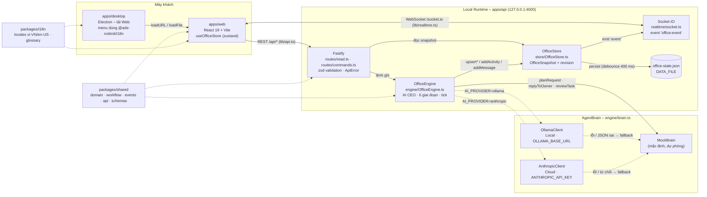
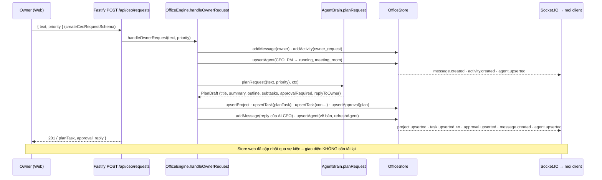

# Kiến trúc hệ thống – ARCHITECTURE

**Sản phẩm:** ADS-NOLIMIT AI OFFICE – Trung tâm điều hành công ty AI · **Kiến trúc:** Hybrid Local + Cloud (kết hợp cục bộ và
đám mây) · **Trạng thái:** MVP v1.0
**Tài liệu liên quan:** [PRD.md](./PRD.md) · [IMPLEMENTATION_CHECKLIST.md](./IMPLEMENTATION_CHECKLIST.md) ·
[VIETNAMESE_UI_LANGUAGE_STANDARD.md](./VIETNAMESE_UI_LANGUAGE_STANDARD.md) · [UI_DESIGN_SYSTEM.md](./UI_DESIGN_SYSTEM.md)

> Tài liệu này mô tả **triển khai thật** trong repo (tên tệp, lệnh, biến môi trường, endpoint, sự kiện). Khi mã nguồn và tài
> liệu lệch nhau, sửa cả hai trong cùng một PR. Kiến trúc Hybrid Local + Cloud, mô hình AI CEO, quy trình 6 giai đoạn và thiết
> kế văn phòng 3D là những quyết định **đã thống nhất, không thay đổi** (xem mục 14).

## Mục lục

1. [Tổng quan kiến trúc Hybrid Local + Cloud](#1-tổng-quan-kiến-trúc-hybrid-local--cloud)
2. [Sơ đồ thành phần](#2-sơ-đồ-thành-phần)
3. [Nguyên tắc Single Source of Truth](#3-nguyên-tắc-single-source-of-truth)
4. [Luồng sự kiện realtime](#4-luồng-sự-kiện-realtime)
5. [Hợp đồng API](#5-hợp-đồng-api)
6. [Mã lỗi chuẩn và cách giao diện dịch](#6-mã-lỗi-chuẩn-và-cách-giao-diện-dịch)
7. [Engine điều phối (OfficeEngine)](#7-engine-điều-phối-officeengine)
8. [Nhà cung cấp mô hình AI (AgentBrain)](#8-nhà-cung-cấp-mô-hình-ai-agentbrain)
9. [Mô hình dữ liệu (domain.ts)](#9-mô-hình-dữ-liệu-domaints)
10. [Gói i18n dùng chung và Desktop](#10-gói-i18n-dùng-chung-và-desktop)
11. [Cấu trúc thư mục](#11-cấu-trúc-thư-mục)
12. [Biến môi trường](#12-biến-môi-trường)
13. [Chạy, build, kiểm thử](#13-chạy-build-kiểm-thử)
14. [Quyết định kiến trúc (ADR)](#14-quyết-định-kiến-trúc-adr)
15. [Hướng mở rộng](#15-hướng-mở-rộng)

---

## 1. Tổng quan kiến trúc Hybrid Local + Cloud

Hệ thống gồm ba tầng, tất cả trong một monorepo (kho mã nhiều gói) quản lý bằng pnpm workspaces:

| Tầng | Gói | Công nghệ | Vai trò |
|---|---|---|---|
| **Giao diện** | `apps/web` | React 19, Vite 7, TypeScript strict, Tailwind v4, zustand, react-router-dom v7, react-i18next, recharts, three + @react-three/fiber 9 + @react-three/drei 10, socket.io-client | Web app vi-VN mặc định: 15 phân hệ, văn phòng 3D, store duy nhất |
| | `apps/desktop` | Electron 38, esbuild | Ứng dụng máy tính bọc giao diện Web, menu/hộp thoại dùng chung từ điển |
| **Local Runtime** (môi trường chạy cục bộ) | `apps/api` | Fastify 5, Socket.IO 4, zod 4, tệp JSON trạng thái | Nguồn dữ liệu duy nhất, engine điều phối nhân sự AI, phát sự kiện realtime |
| **Nhà cung cấp mô hình AI** | `apps/api/src/engine/providers` | `MockBrain` (mặc định), `OllamaClient` (cục bộ, HTTP), `AnthropicClient` (đám mây, `@anthropic-ai/sdk`) | "Bộ não" cho lập kế hoạch, trả lời Owner, kiểm định chất lượng |
| **Dùng chung** | `packages/shared` | TypeScript thuần + zod | Kiểu dữ liệu miền, hằng quy trình, hợp đồng API, sự kiện, schema kiểm tra |
| | `packages/i18n` | i18next, tệp JSON locale, bảng thuật ngữ | Từ điển vi-VN/en-US + glossary cho Web, Desktop và backend |

**Hybrid** nghĩa là: dữ liệu vận hành, trạng thái và engine luôn ở **Local** (máy doanh nghiệp, `apps/api` lắng nghe
`127.0.0.1:4000`); riêng "bộ não" của từng nhân sự AI có thể là mô hình cục bộ (Ollama) hoặc đám mây (Anthropic Claude), chọn
bằng biến môi trường `AI_PROVIDER` cho toàn hệ thống, và được **ghi nhận theo từng nhân sự** trong `Agent.model`
(`mode: 'local' | 'cloud' | 'hybrid'`, `provider`, `model`) để hiển thị. Chế độ vận hành của công ty (`company.executionMode`)
do Owner chọn trong Cài đặt. Mặc định `AI_PROVIDER=mock`: không cần mạng, không cần khóa, hệ thống vẫn chạy đầy đủ.

---

## 2. Sơ đồ thành phần



Luồng tuần tự khi Owner giao yêu cầu cho AI CEO:



---

## 3. Nguyên tắc Single Source of Truth

**Một `OfficeSnapshot`** (ảnh chụp trạng thái văn phòng, `packages/shared/src/domain.ts`) do backend phát hành là nguồn dữ
liệu duy nhất. Chuỗi bắt buộc:

```
OfficeStore (backend) ──snapshot/sự kiện──▶ useOfficeStore (web, 1 store zustand) ──selectors.ts──▶ Tổng quan · Bảng điều khiển ·
Sơ đồ tổ chức · Văn phòng 3D · mọi trang khác
```

### 3.1 Phía backend – `apps/api/src/store/OfficeStore.ts`

- Mọi thay đổi đi qua `upsertTask`, `removeTask`, `upsertAgent`, `upsertApproval`, `addActivity` (giữ 500 mới nhất),
  `upsertProject`, `setKpis`, `addMessage` (giữ 1000), `updateCompany`, `replace`. Không module nào sửa snapshot trực tiếp
  (ngoại lệ duy nhất hiện có: `decideApproval` cập nhật `connectors` trong snapshot khi duyệt loại `connector` – xem mục 15).
- Mỗi lần ghi: `bump()` tăng `revision`, cập nhật `updatedAt`, `emit('event', OfficeEvent)` và `schedulePersist()` (debounce
  400 ms xuống `DATA_FILE`). `persistNow()` được gọi khi tắt máy chủ.
- `OfficeStore.loadOrSeed(createSeedSnapshot, dataFile, reset)`: đọc tệp nếu có và hợp lệ (có mảng `agents`, `tasks`), ngược
  lại hoặc khi `SEED_RESET=1` thì dựng từ `seed.ts`.

### 3.2 Phía web – `apps/web/src/store/officeStore.ts`

- Một store zustand `useOfficeStore` gồm dữ liệu (`hydrated`, `revision`, `updatedAt`, `company`, `departments`, `agents`,
  `tasks`, `approvals`, `projects` dạng `Record<id, …>`; `connectors`, `activities` (≤ 300), `messages` (≤ 500), `kpis`) và UI
  state (`connection`, `lastError`, `selectedAgentId`, `selectedDepartmentId`, `selectedTaskId`, `cameraFocusAgentId`,
  `sidebarCollapsed`).
- `hydrate(snapshot)` nạp toàn bộ; `applyEvent(event)` áp từng sự kiện và **bỏ qua sự kiện có `revision` cũ hơn** bản đang
  có (trừ khi chưa hydrate).
- **Quy tắc dùng store** (`src/store/hooks.ts`): giá trị nguyên thủy/tham chiếu sẵn có → `useOfficeStore((s) => s.connection)`,
  `useOfficeStore((s) => s.agents[id])`; selector **tạo object/array mới** (lọc, gom nhóm, tính toán) → **bắt buộc**
  `useDerived(selector, deps)` (hoặc `useAgents`/`useTasks`/`useApprovals`/`useProjects`). Dùng `useOfficeStore` trực tiếp với
  selector tạo object mới gây vòng lặp render vô hạn của `useSyncExternalStore`.
- Selector dùng chung `src/store/selectors.ts`: `selectHeadlineStats`, `selectTaskCounts`, `selectAgentCounts`,
  `selectStageCounts`, `selectTodaysKeyTasks(limit)`, `selectRecentActivities(limit)`, `selectPendingApprovals`,
  `selectOrgTree`, `selectAgentsByDepartment`, `selectTasksByAgent`, `selectTasksByDepartment`, `selectAgentWorkload`,
  `selectDepartmentSummary`, `selectMessagesForAgent`, … Mọi con số trên các trang phải lấy từ cùng selector để khớp nhau.
  Selector riêng của một phân hệ đặt trong `features/<gói>/selectors.ts` và chỉ tính từ store.
- Sau khi gọi API ghi (`src/lib/api.ts`) **không refetch**: phản hồi HTTP chỉ dùng để hiển thị kết quả tức thì nếu cần; dữ liệu
  chính thức đến qua realtime.

### 3.3 Văn phòng 3D cũng đọc store

`features/office3d/scene/layout.ts` suy mặt bằng từ `departments[].bounds` và `agents[].desk`/`location` – không có tọa độ
phòng nào viết cứng ngoài hằng hiển thị (`PLAN`, `HALL_CENTER`, `CAMERA_OFFSET`). Mỗi `AgentFigure` chỉ đăng ký lát
`agents[id]`; `DepartmentPanel` dùng `selectDepartmentSummary` nên số trong bảng 3D = số trên Sơ đồ tổ chức.

---

## 4. Luồng sự kiện realtime

Định nghĩa trong `packages/shared/src/events.ts`; máy chủ `apps/api/src/realtime/socket.ts`; máy khách `apps/web/src/lib/realtime.ts`.

| Hằng số | Giá trị | Ý nghĩa |
|---|---|---|
| `SOCKET_EVENT_NAME` | `'office:event'` | Mọi sự kiện backend → client đi qua tên này, payload là `OfficeEvent` |
| `SOCKET_HELLO_NAME` | `'office:hello'` | Client → server `{ client: 'web', revision }`; nếu `revision` lệch, server gửi lại `snapshot` |
| Đường dẫn | `/socket.io` | Vite dev/preview proxy tới `VITE_API_PROXY_TARGET` (mặc định `http://localhost:4000`) với `ws: true` |

### 4.1 Các loại `OfficeEvent`

| `type` | Dữ liệu kèm | Phát khi (OfficeStore) |
|---|---|---|
| `snapshot` | `snapshot: OfficeSnapshot` | Client vừa kết nối; `revision` lệch khi hello; `updateCompany`; `replace` (đặt lại dữ liệu mẫu) |
| `task.upserted` | `task`, `revision` | `upsertTask` |
| `task.removed` | `taskId`, `revision` | `removeTask` |
| `agent.upserted` | `agent`, `revision` | `upsertAgent` (trạng thái, vị trí 3D, `currentTaskId`, `tasksCompleted`) |
| `approval.upserted` | `approval`, `revision` | `upsertApproval` |
| `activity.created` | `activity`, `revision` | `addActivity` |
| `project.upserted` | `project`, `revision` | `upsertProject` |
| `kpi.updated` | `kpis`, `revision` | `setKpis` (hiện chưa có luồng gọi trong engine – KPI đến từ seed/snapshot) |
| `message.created` | `message`, `revision` | `addMessage` |

### 4.2 Vòng đời kết nối phía web (`startRealtime()` gọi một lần trong `main.tsx`)

1. `setConnection('connecting')`; tải `GET /api/state` → `hydrate` (hoặc `offline` kèm thông điệp lỗi).
2. Mở Socket.IO (`transports: ['websocket', 'polling']`, `reconnectionDelay` 1 000 → tối đa 8 000 ms).
3. `connect` → `live`, gửi `office:hello { client: 'web', revision }`, dừng polling.
4. `office:event` → `applyEvent`.
5. `disconnect` → `reconnecting` (mã `websocket_disconnected`), bật polling `GET /api/state` mỗi 15 giây, chỉ `hydrate` khi
   `revision` khác. `connect_error` → `offline`.
6. `refreshSnapshot()` – nút "Làm mới dữ liệu" trong Cài đặt – tải lại toàn bộ snapshot theo yêu cầu.

`ConnectionBanner` và `RealtimeIndicator` hiển thị `connection` bằng tiếng Việt (`common:status.*`, `activity:realtime.*`).

---

## 5. Hợp đồng API

Hằng `API_ROUTES` và kiểu body/response trong `packages/shared/src/api.ts`; schema zod trong `packages/shared/src/schemas.ts`;
máy khách `apps/web/src/lib/api.ts` (`api.*`). Đường dẫn là định danh kỹ thuật, không dịch. Mọi body là JSON.

### 5.1 Route đọc (`apps/api/src/routes/read.ts`)

| Phương thức & đường dẫn | `API_ROUTES` | Trả về |
|---|---|---|
| `GET /api/health` | `health` | `{ ok, revision, executionMode, updatedAt }` |
| `GET /api/state` | `state` | `OfficeSnapshot` đầy đủ (`SnapshotResponse`) |
| `GET /api/agents` | `agents` | `Agent[]` |
| `GET /api/tasks` | `tasks` | `Task[]` |
| `GET /api/approvals` | `approvals` | `Approval[]` |
| `GET /api/activities?limit=100` | `activities` | `ActivityEvent[]` (limit 1–500) |
| `GET /api/projects` | `projects` | `Project[]` |
| `GET /api/connectors` | `connectors` | `Connector[]` |
| `GET /api/kpis` | `kpis` | `KpiSummary` |

### 5.2 Route lệnh (`apps/api/src/routes/commands.ts`)

| Phương thức & đường dẫn | `API_ROUTES` | Body (schema) | Response | Engine | Lỗi nghiệp vụ |
|---|---|---|---|---|---|
| `POST /api/ceo/requests` | `ceoRequests` | `CreateCeoRequestBody { text: 3–4000 ký tự, priority? }` (`createCeoRequestSchema`) | `201 CreateCeoRequestResponse { planTask, approval?, reply }` | `handleOwnerRequest` | `agent_paused` (AI CEO tạm dừng), `not_found` (không có AI CEO) |
| `POST /api/tasks` | `tasks` | `CreateTaskBody { title: 2–300, description? ≤5000, assigneeId?, priority?, dueAt?, projectId?, departmentId? }` | `201 Task` | `createTask` | `not_found`, `agent_paused` |
| `PATCH /api/tasks/:taskId` | `taskById(id)` | `UpdateTaskBody { status?, assigneeId?: string\|null, priority?, progress? 0–100, focus?, dueAt?: string\|null }` | `Task` | `updateTask` | `not_found`, `agent_paused` |
| `POST /api/approvals/:approvalId/approve` | `approvalDecide(id,'approve')` | `DecideApprovalBody { note? ≤2000 }` | `Approval` | `decideApproval` | `not_found`, `approval_already_decided` |
| `POST /api/approvals/:approvalId/reject` | `approvalDecide(id,'reject')` | như trên | `Approval` | `decideApproval` | như trên |
| `POST /api/agents/:agentId/pause` | `agentPause(id)` | – | `Agent` | `pauseAgent` | `not_found` |
| `POST /api/agents/:agentId/resume` | `agentResume(id)` | – | `Agent` | `resumeAgent` | `not_found` |
| `POST /api/agents/:agentId/messages` | `messages(id)` | `SendAgentMessageBody { text: 1–4000 }` | `201 SendAgentMessageResponse { owner, reply }` | `sendMessage` | `not_found` |
| `PATCH /api/settings` | `settings` | `UpdateSettingsBody { executionMode?, ownerName? 1–120, companyName? 1–120 }` | `CompanyInfo` | `updateSettings` | `validation_failed` |
| `POST /api/admin/reset` | (không có trong `API_ROUTES`) | – | `{ ok, revision }` | `store.replace(createSeedSnapshot())` | Chỉ dùng phát triển/demo |
| `POST /api/admin/tick` | (không có trong `API_ROUTES`) | – | `{ ok, revision }` | `engine.tick()` | Chỉ dùng phát triển/demo |

Máy khách web: `api.health`, `api.getState`, `api.createCeoRequest`, `api.createTask`, `api.updateTask`, `api.decideApproval`,
`api.pauseAgent`, `api.resumeAgent`, `api.sendAgentMessage`, `api.updateSettings`. Tiền tố `VITE_API_BASE_URL` (mặc định rỗng →
cùng origin, đi qua proxy Vite).

---

## 6. Mã lỗi chuẩn và cách giao diện dịch

Backend (`apps/api/src/errors.ts`, `app.ts`) luôn trả `ApiErrorBody { code, message, details? }` – `code` là định danh kỹ thuật,
`message` là mô tả kỹ thuật tiếng Anh phục vụ log. `setErrorHandler` ánh xạ `ApiError`, `ZodError` (→ `validation_failed` kèm
`issues`) và lỗi Fastify khác; `setNotFoundHandler` → `not_found`.

| `ApiErrorCode` | HTTP (`STATUS_BY_CODE`) | Khi nào |
|---|---|---|
| `not_found` | 404 | Không tìm thấy Agent/Task/Approval, route không tồn tại |
| `validation_failed` | 400 | Body sai schema zod |
| `conflict` | 409 | Dự phòng cho xung đột dữ liệu |
| `agent_paused` | 409 | Giao việc / gửi yêu cầu cho nhân sự đang tạm dừng |
| `approval_already_decided` | 409 | Quyết định lại một phê duyệt đã duyệt/từ chối |
| `provider_unavailable` | 503 | Dự phòng khi nhà cung cấp mô hình không khả dụng (hiện engine tự fallback nên hiếm gặp) |
| `rate_limited` | 429 | Dự phòng |
| `internal` | 500 | Lỗi không mong muốn |

Phía web, `lib/api.ts` ném `ApiError` (`code: ApiErrorCode | 'network'`, `status`, `details`); mất mạng → `'network'`; mất
WebSocket → `lastError = 'websocket_disconnected'`. Giao diện **không** hiển thị `message` tiếng Anh mà dùng
`describeError(t, code)` (`packages/i18n/src/index.ts`) → `errors:codes.<code>.title` / `.explain` (tiếng Việt, phần giải
thích mở đầu bằng thuật ngữ tiếng Anh, ví dụ "Agent Paused – Hãy cho nhân sự AI tiếp tục (Resume) trước khi giao việc").
Mã chưa có bản dịch → dùng `internal` kèm mã trong ngoặc. Thành phần dùng chung: `<ErrorBanner error={err} onRetry={…}/>`.

---

## 7. Engine điều phối (OfficeEngine)

`apps/api/src/engine/OfficeEngine.ts` – thực thi mô hình AI CEO và quy trình 6 giai đoạn; mọi thay đổi đi qua `OfficeStore`.

| Thành phần | Mô tả |
|---|---|
| `new OfficeEngine(store, { provider, simulation?, tickMs?, random? })` | `simulation` mặc định `true` (tắt trong kiểm thử); `tickMs` mặc định 5 000 ms; `random` thay thế được để kiểm thử xác định |
| `start()` / `stop()` | Bật/tắt `setInterval(tick)` (có `unref`) |
| `handleOwnerRequest(text, priority='high')` | Mục 2 (sơ đồ tuần tự). CEO và PM vào `meeting_room` khi lập kế hoạch; PM chọn người thực hiện bằng `pickAssignee(departmentId, role)` → cùng phòng & vai trò → cùng vai trò → bất kỳ trong phòng, ưu tiên ít việc (`leastLoaded`); dự án mới `endAt = +30 ngày`; con `dueAt = +3, +5, +7…`. Tên dự án = tiêu đề kế hoạch bỏ tiền tố "Kế hoạch:" |
| `createTask(body)` | Có người phụ trách → `in_progress`, `stage: 'execute'`, ghi `task_started`; không → `not_started`, `stage: 'receive'`. `departmentId` = body → phòng của người phụ trách → `executive` |
| `updateTask(id, patch)` | Áp patch; đổi người phụ trách kéo theo `departmentId`; `applyStatus` đồng bộ `stage`/`startedAt`/`completedAt`/`progress`; ghi hoạt động `task_completed`/`task_started`; tính lại dự án |
| `decideApproval(id, 'approve'\|'reject', note?)` | Luật phê duyệt (PRD mục 6.2); AI CEO nhắn Owner bằng tiếng Việt qua `notifyOwnerFromCeo` |
| `pauseAgent(id)` / `resumeAgent(id)` | PRD mục 6.3 |
| `sendMessage(agentId, text)` | Lưu tin Owner, trả lời qua `provider.replyToOwner` (hoặc câu cố định khi tạm dừng), ghi `agent_message` |
| `updateSettings(patch)` | `store.updateCompany` → phát `snapshot` |
| `tick()` | Một nhịp mô phỏng: (1) việc `in_progress` tiến 1–4 % (ưu tiên cao) / 1–3 %, đạt 100 % → `moveToReview`; cứ 12 nhịp có 30 % cơ hội ghi `task_progress`; (2) việc `in_review` có 12 % cơ hội `completeReview`; (3) việc quá hạn (không phải `completed`/`needs_approval`/`blocked`) → `overdue`; (4) khởi động việc `not_started` đã có người phụ trách; (5) `generateRoutineWork`; (6) `refreshAgent` mọi nhân sự, `refreshProjectProgress` mọi dự án |
| `generateRoutineWork()` | Chỉ khi `simulation`, mỗi 12 nhịp (~1 phút), khi < 3 việc đang chạy và PM không tạm dừng: chọn ngẫu nhiên một mẫu trong `ROUTINE_TASKS` (8 mẫu tiếng Việt: tối ưu quảng cáo theo CPL, soạn bài, phản hồi khách, cập nhật KPI, chấm điểm lead, kiểm tra webhook, kịch bản video, phân tích đối thủ), bỏ qua nếu đã có việc cùng tiêu đề chưa xong; `tags: ['thường kỳ']` |
| `moveToReview(task)` | `in_review`/`stage: 'review'` nếu có QA không tạm dừng, ngược lại `completed`; ghi `task_completed`; QA `running`, `currentTaskId`, `location: { kind: 'department', departmentId: task.departmentId }` |
| `completeReview(task)` | `provider.reviewTask` → đạt: `completed`, `tasksCompleted + 1`, `review_passed`; không đạt: `in_progress`, `progress = max(40, progress − 35)`, `review_failed`. QA chuyển sang việc `in_review` kế tiếp hoặc về bàn |
| `startQueuedTasks(ids)` | Đưa `not_started`/`pending` vào `in_progress`, tối đa `MAX_CONCURRENT_PER_AGENT = 2`/nhân sự; vượt giới hạn → `pending`, `stage: 'assign'` |
| `refreshAgent(id)` | Suy `status`/`currentTaskId` từ dữ liệu công việc (PRD mục 4.1); giữ `location` nếu đang `meeting_room`/`department`, ngược lại về `desk`; không ghi đè `paused`/`error`; chỉ `upsertAgent` khi có thay đổi |
| `refreshProjectProgress(projectId)` | `progress` = trung bình (`completed` tính 100); `completed` khi tất cả xong; `planning` → `active` khi có việc chạy |

**Vị trí 3D của Agent** (`AgentLocation`) là quyết định của engine: `desk` mặc định; `meeting_room` khi CEO/PM lập kế hoạch;
`department` khi QA kiểm định; `pantry` khi tạm dừng; `reception` dự phòng. Frontend chỉ nội suy chuyển động tới vị trí mục tiêu.

Kiểm thử: `apps/api/src/engine/OfficeEngine.test.ts` (vitest, 7 ca) – yêu cầu Owner tạo kế hoạch/con/phê duyệt/phản hồi tiếng
Việt; duyệt kích hoạt con; từ chối chặn con; mô phỏng thực thi → QA di chuyển → hoàn thành; tạm dừng/tiếp tục; cập nhật công
việc & tiến độ dự án; nhắn tin nhận phản hồi tiếng Việt.

---

## 8. Nhà cung cấp mô hình AI (AgentBrain)

`apps/api/src/engine/brain.ts` định nghĩa giao diện trừu tượng:

```ts
interface AgentBrain {
  name: string; mode: 'local' | 'cloud' | 'hybrid';
  planRequest(input: { text; priority }, ctx: BrainContext): Promise<PlanDraft>;
  replyToOwner(agent: Agent, text: string, ctx: BrainContext & { agentTasks: Task[] }): Promise<string>;
  reviewTask(task: Task, ctx: BrainContext): Promise<ReviewVerdict>;
  isAvailable(): Promise<boolean>;
}
```

`createProvider(process.env)` (`providers/index.ts`) chọn theo `AI_PROVIDER`:

| Giá trị | Lớp | Chi tiết |
|---|---|---|
| `mock` (mặc định) | `MockBrain` (`providers/mock.ts`) | Định tuyến phòng ban theo từ khóa tiếng Việt/Anh (`KEYWORDS`), trích số ngày và mục tiêu %, luôn thêm việc đo KPI (`data_analytics`) và kiểm định (`strategy`, `role: 'ai_qa_reviewer'`), `approvalRequired: true`; trả lời Owner theo mẫu có mở đầu bằng chức vụ song ngữ; kiểm định đạt 82 % (ưu tiên cao) / 90 % |
| `ollama` | `LlmBrain(new OllamaClient(OLLAMA_BASE_URL, OLLAMA_MODEL))` (`providers/llm.ts`) | `POST {base}/api/generate` (`stream: false`, timeout 60 s); `isAvailable` = `GET /api/tags` (2 s). Mặc định `http://127.0.0.1:11434`, `qwen2.5:14b` |
| `anthropic` | `LlmBrain(new AnthropicClient({ apiKey, model }))` (`providers/anthropic.ts`) | `client.messages.create` (`max_tokens: 4096`, `system`, 1 tin nhắn user); `stop_reason === 'refusal'` → ném lỗi để fallback. Mặc định `claude-opus-5-5`; `isAvailable` = có `ANTHROPIC_API_KEY` hoặc `ANTHROPIC_AUTH_TOKEN` |

`LlmBrain` luôn tạo bản nháp từ `MockBrain` trước, rồi cố gắng nâng cấp bằng mô hình thật: trích JSON từ đầu ra, lọc `subtasks`
có `departmentId` hợp lệ (tối đa 8), gán QA cho phòng `strategy`; mọi lỗi/đầu ra rỗng → dùng bản mock. Prompt hệ thống
`SYSTEM_VI` yêu cầu trả lời Owner bằng tiếng Việt, thuật ngữ kèm nghĩa trong ngoặc, không dịch định danh kỹ thuật.

---

## 9. Mô hình dữ liệu (domain.ts)

`packages/shared/src/domain.ts` – dùng chung backend và frontend qua `import type { … } from '@ads-nolimit/shared'`. Nhãn hiển
thị **không** nằm ở đây (dịch qua i18n bằng id); văn bản do Agent tạo là dữ liệu nguyên văn.

### 9.1 Kiểu liệt kê

| Kiểu | Giá trị | Nhãn song ngữ |
|---|---|---|
| `Locale` | `'vi-VN' \| 'en-US'` | – |
| `DepartmentId` | `executive`, `strategy`, `marketing`, `creative_media`, `social_community`, `data_analytics`, `sales_crm`, `tech_automation`, `meeting_room`, `reception`, `pantry` | `department.*` |
| `AgentRole` | `ai_ceo`, `ai_coo`, `ai_project_manager`, `ai_specialist`, `ai_qa_reviewer` | `role.*` |
| `AgentStatus` | `active`, `running`, `waiting`, `idle`, `paused`, `error` | `agent_status.*` |
| `TaskStatus` | `not_started`, `in_progress`, `pending`, `needs_approval`, `in_review`, `completed`, `blocked`, `overdue` | `task_status.*` |
| `TaskPriority` | `high`, `medium`, `low` | `priority.*` |
| `WorkflowStage` | `receive`, `plan`, `assign`, `execute`, `review`, `report` | `stage.*` |
| `ApprovalType` | `plan`, `budget`, `content`, `publish`, `connector` | `approval_type.*` |
| `ApprovalStatus` | `pending`, `approved`, `rejected` | `approval_status.*` |
| `ProjectStatus` | `planning`, `active`, `on_hold`, `completed` | `project_status.*` |
| `ExecutionMode` | `local`, `cloud`, `hybrid` | `execution_mode.*` |
| `AgentLocation` | `{kind:'desk'}` \| `{kind:'department', departmentId}` \| `{kind:'meeting_room'}` \| `{kind:'reception'}` \| `{kind:'pantry'}` | – |

### 9.2 Thực thể

**`OfficeSnapshot`**

| Trường | Kiểu | Ghi chú |
|---|---|---|
| `company` | `CompanyInfo` | `name`, `tagline`, `ownerName`, `executionMode`, `version` |
| `departments` | `Department[]` | 11 khu, nguồn mặt bằng 3D |
| `agents` | `Agent[]` | |
| `tasks` | `Task[]` | |
| `approvals` | `Approval[]` | |
| `activities` | `ActivityEvent[]` | mới nhất trước, ≤ 500 |
| `projects` | `Project[]` | |
| `connectors` | `Connector[]` | |
| `kpis` | `KpiSummary` | |
| `messages` | `ChatMessage[]` | ≤ 1000 |
| `updatedAt` | ISO string | |
| `revision` | number | tăng mỗi lần ghi |

**`Department`**

| Trường | Kiểu | Ghi chú |
|---|---|---|
| `id` | `DepartmentId` | |
| `accent` | hex | màu neon phòng và biểu đồ (khớp token `--color-dept-*`) |
| `bounds` | `{ x, z, width, depth }` | mét ảo trên mặt bằng |
| `functional?` | boolean | phòng chức năng (họp, sảnh, pantry) |
| `headAgentId?`, `managerAgentId?` | string | dự phòng |

**`Agent`**

| Trường | Kiểu | Ghi chú |
|---|---|---|
| `id` | string | ví dụ `agent_ceo` |
| `role` | `AgentRole` | hiển thị song ngữ |
| `displayName?` | string | tên do Owner đặt (dữ liệu, nguyên văn) |
| `departmentId` | `DepartmentId` | biên chế |
| `reportsTo?` | string | cây tổ chức |
| `status` | `AgentStatus` | suy bởi engine |
| `currentTaskId?` | string | |
| `performance` | 0..100 | |
| `skills` | `AgentSkill[]` (`{ id, level }`) | id kỹ thuật, nhãn `connectors:skills.<id>` |
| `connectorIds` | string[] | |
| `model` | `AgentModelConfig { mode, provider, model }` | ví dụ `ollama` / `qwen2.5:14b` |
| `location` | `AgentLocation` | vị trí 3D |
| `desk` | `Vec3 { x, y, z }` | tọa độ bàn tuyệt đối |
| `avatarSeed` | string | |
| `tasksCompleted` | number | |
| `createdAt`, `updatedAt` | ISO | |

**`Task`**

| Trường | Kiểu | Ghi chú |
|---|---|---|
| `id` | string | `task_xxxxxxxxxx` (`newId('task')`) |
| `projectId?`, `parentId?` | string | con của `planTask` |
| `title`, `description?` | string | dữ liệu nguyên văn |
| `status` | `TaskStatus` | |
| `stage` | `WorkflowStage` | |
| `priority` | `TaskPriority` | |
| `assigneeId?`, `requesterId?` | string | `requesterId = 'owner'` khi Owner tạo |
| `departmentId` | `DepartmentId` | |
| `progress` | 0..100 | |
| `dueAt?`, `startedAt?`, `completedAt?`, `createdAt`, `updatedAt` | ISO | |
| `tags` | string[] | ví dụ `'kế hoạch'`, `'thường kỳ'` |
| `focus?` | boolean | công việc trọng tâm hôm nay |

**`Approval`**: `id`, `type`, `title`, `summary?`, `requestedBy`, `taskId?`, `projectId?`, `status`, `amountVnd?`, `decidedAt?`,
`decisionNote?`, `createdAt`.

**`ActivityEvent`**: `id`, `agentId?`, `taskId?`, `approvalId?`, `kind` (`plan_created`, `tasks_created`, `task_started`,
`task_progress`, `task_completed`, `review_passed`, `review_failed`, `approval_requested`, `approval_decided`, `agent_message`,
`agent_paused`, `agent_resumed`, `owner_request`, `system`), `templateKey` (khóa `activity:templates.*`, ví dụ
`approval_approved`/`approval_rejected` cho `kind: 'approval_decided'`), `params` (`agent`, `title`, `count`, `progress`…),
`text?` (văn bản Agent tự viết), `createdAt`.

**`Project`**: `id`, `name`, `objective?`, `status`, `ownerAgentId`, `departmentIds`, `progress`, `startAt`, `endAt?`, `budgetVnd?`.

**`KpiSummary`**: `leadsGrowthPct`, `conversionGrowthPct`, `costPerLeadChangePct`, `roi`, `period` (`this_month` | `last_month` |
`quarter`), `series: KpiPoint[]` (`label` ví dụ `W1` → "Tuần 1", `reach`, `leads`, `conversionRate`).

**`Connector`**: `id` (ví dụ `meta_ads`), `vendor` (tên thương hiệu, không dịch), `category` (`ads`, `storage`, `analytics`, `crm`,
`communication`, `ai_model`), `connected`, `mode`, `lastSyncAt?`.

**`ChatMessage`**: `id`, `agentId`, `from` (`owner` | `agent`), `text`, `createdAt`, `relatedTaskIds?`.

### 9.3 Hằng và hàm quy trình (`workflow.ts`)

`WORKFLOW_STAGES`, `TASK_STATUSES`, `AGENT_ROLES`, `DEPARTMENT_IDS`, `STAGE_OWNER_ROLE`, `STAGE_ORDER`, `nextStage(stage)`,
`TERMINAL_TASK_STATUSES = ['completed']`, `isTaskOpen(status)`.

---

## 10. Gói i18n dùng chung và Desktop

### 10.1 `packages/i18n`

| Tệp | Vai trò |
|---|---|
| `src/glossary.ts` | `GLOSSARY: GlossaryEntry[]` (`id`, `category`, `en`, `vi`, `viShort?`, `noteVi?`) – 15 nhóm: `module`, `role`, `department`, `task_status`, `agent_status`, `priority`, `stage`, `approval_type`, `approval_status`, `project_status`, `metric`, `tech`, `action`, `connector_category`, `execution_mode`. `getGlossaryEntry`, `listGlossary(category?)`, `englishTermSet()`, `buildGlossaryResources(locale)` sinh namespace `glossary` (`label`, `short`, `secondary`, `inline`, `note`) |
| `src/resources.ts` | `NAMESPACES` (20: `common`, `nav`, `glossary`, `activity`, `errors`, `overview`, `dashboard`, `office3d`, `ceo`, `agents`, `tasks`, `workflow`, `approvals`, `orgchart`, `projects`, `reports`, `settings`, `connectors`, `knowledge`, `desktop`), `SUPPORTED_LOCALES`, `DEFAULT_LOCALE = FALLBACK_LOCALE = 'vi-VN'`, `resources` nạp từ `locales/<locale>/<ns>.json` |
| `src/index.ts` | `initI18n({ lng?, instance?, overrides? })`, `LOCALE_STORAGE_KEY = 'ads-nolimit.locale'`, `isLocale`, `normalizeLocale`, `bilingual(id, locale)` / `bilingualSafe` → `BilingualLabel { primary, secondary, inline, short, note, term, meaning }`, `TERM_SEPARATOR = ' – '`, `termIdFor*` (Role, Department, TaskStatus, AgentStatus, Priority, Stage, ApprovalType, ApprovalStatus, ProjectStatus, ExecutionMode), `roleTitle`, `describeError` |
| `src/react.tsx` (`@ads-nolimit/i18n/react`) | `useLocale`, `useTerm`, `useTerms`, `<Term id format="inline\|stacked\|primary\|short\|secondary"/>` (mọi dạng có `title` "EN – VI"), `<BilingualText primary secondary/>` |
| `locales/vi-VN/*.json`, `locales/en-US/*.json` | Cùng tập khóa; cặp `label`/`secondary`; số nhiều `key_one`/`key_other` |
| `src/glossary.test.ts` | 8 ca: id không trùng, một EN → một VI trong nhóm, nghĩa VI có dấu, dạng "EN – VI", khớp khóa hai locale, khởi tạo vi-VN, tên chức vụ, diễn giải mã lỗi |

Web khởi tạo trong `apps/web/src/i18n.ts`: `LanguageDetector` chỉ đọc `localStorage` (không suy từ trình duyệt), `fallbackLng`
vi-VN, đặt `document.documentElement.lang`. `changeLocale(locale)` lưu lựa chọn.

### 10.2 Desktop dùng chung từ điển

`apps/desktop/src/main.ts` gọi `initI18n({ lng: 'vi-VN' })` trong tiến trình chính, dựng menu bằng `t('desktop:menu.*')` và
`termLabel(id)` ("Cài đặt hệ thống – Settings"), menu điều hướng tới `/`, `/dashboard`, `/office`, `/ceo`, `/tasks`,
`/approvals`, `/settings`; đổi ngôn ngữ qua menu phát `desktop:locale-changed`. `preload.ts` lộ `window.adsNolimitDesktop`
(`platform`, `version`, `getLocale`, `setLocale`). `build.mjs` đóng gói `main.cjs`/`preload.cjs` bằng esbuild (CommonJS, node20,
`external: ['electron']`).

---

## 11. Cấu trúc thư mục

```
.
├── package.json                 # scripts gốc: dev, dev:desktop, build, typecheck, test, lint:i18n, glossary:docs, e2e, check
├── pnpm-workspace.yaml          # apps/*, packages/*
├── tsconfig.base.json           # strict, noUncheckedIndexedAccess, ES2022, Bundler
├── CLAUDE.md                    # quy tắc cho mọi phiên Claude Code / kỹ sư
├── README.md
├── docs/
│   ├── PRD.md · ARCHITECTURE.md · IMPLEMENTATION_CHECKLIST.md
│   ├── VIETNAMESE_UI_LANGUAGE_STANDARD.md · UI_DESIGN_SYSTEM.md
│   └── GLOSSARY.md              # sinh tự động (pnpm glossary:docs)
├── scripts/
│   ├── i18n-lint.ts             # pnpm lint:i18n
│   └── generate-glossary-doc.ts # pnpm glossary:docs
├── packages/
│   ├── shared/src/              # domain.ts · workflow.ts · events.ts · api.ts · schemas.ts · index.ts
│   └── i18n/
│       ├── src/                 # glossary.ts · resources.ts · index.ts · react.tsx · glossary.test.ts
│       └── locales/{vi-VN,en-US}/*.json
└── apps/
    ├── api/
    │   ├── data/                # office-state.json (bỏ qua trong git, .gitkeep)
    │   └── src/
    │       ├── server.ts        # điểm khởi động, đọc biến môi trường
    │       ├── app.ts           # buildApp: Fastify + CORS + xử lý lỗi chuẩn
    │       ├── errors.ts · ids.ts
    │       ├── seed.ts          # dữ liệu mẫu tiếng Việt, DEPARTMENTS (mặt bằng 3D)
    │       ├── store/OfficeStore.ts
    │       ├── engine/          # OfficeEngine.ts · brain.ts · providers/{index,mock,llm,anthropic}.ts · OfficeEngine.test.ts
    │       ├── realtime/socket.ts
    │       └── routes/          # read.ts · commands.ts
    ├── web/
    │   ├── index.html · vite.config.ts · vitest.config.ts
    │   ├── e2e/                 # run.mjs (pnpm e2e) – đang xây dựng
    │   └── src/
    │       ├── main.tsx · i18n.ts
    │       ├── app/             # App.tsx (routes lazy) · routes.ts (ROUTES, NAV_GROUPS)
    │       ├── store/           # officeStore.ts · hooks.ts · selectors.ts
    │       ├── lib/             # api.ts · realtime.ts · format.ts · colors.ts
    │       ├── styles/index.css # token Tailwind v4, utility glass/neon/term-stack
    │       ├── components/
    │       │   ├── ui/          # Card, CardHeader, Badge, Button, ProgressBar, StatCard, EmptyState, ErrorBanner, PageSkeleton
    │       │   ├── domain/      # AgentName, AgentAvatar, DepartmentName, Task/Agent/Priority/Stage/ApprovalStatusBadge
    │       │   └── layout/      # AppShell, Sidebar, Topbar, PageHeader, ConnectionBanner, Logo
    │       ├── features/        # overview · dashboard · office3d · ceo · orgchart · tasks · projects · agents · workflow ·
    │       │                    # approvals · connectors · activity · reports · knowledge · settings
    │       └── pages/           # 15 trang, mỗi trang ghép các feature
    └── desktop/
        ├── build.mjs
        └── src/                 # main.ts · preload.ts
```

Tuyến đường (`routes.ts`): `/` Tổng quan · `/dashboard` · `/office` · `/ceo` · `/tasks` · `/agents` (+ `/agents/:agentId`) ·
`/workflow` · `/approvals` · `/connectors` · `/org-chart` · `/projects` · `/activity` · `/reports` · `/knowledge` · `/settings`;
mọi đường dẫn khác chuyển về `/`.

---

## 12. Biến môi trường

Tất cả là định danh kỹ thuật, đọc trong `apps/api/src/server.ts`, `engine/providers/*`, `apps/web/vite.config.ts`,
`apps/web/src/lib/*`, `apps/desktop/package.json`. Không đặt khóa bí mật vào mã hay tệp trạng thái; `.env`/`.env.local` bị bỏ
qua trong git.

| Biến | Thành phần | Mặc định | Ý nghĩa |
|---|---|---|---|
| `PORT` | api | `4000` | Cổng HTTP + WebSocket |
| `HOST` | api | `127.0.0.1` | Địa chỉ lắng nghe (chỉ máy cục bộ) |
| `CORS_ORIGIN` | api | tất cả (`true`) | Origin cho phép (HTTP và Socket.IO) |
| `DATA_FILE` | api | `apps/api/data/office-state.json` | Tệp trạng thái JSON |
| `SEED_RESET` | api | – | `1` → bỏ tệp cũ, dựng lại dữ liệu mẫu |
| `SIMULATION` | api | bật | `off` → tắt mô phỏng tiến độ tự động (vẫn gọi được `POST /api/admin/tick`) |
| `AI_PROVIDER` | api | `mock` | `mock` \| `ollama` \| `anthropic` |
| `OLLAMA_BASE_URL` | api | `http://127.0.0.1:11434` | Máy chủ Ollama |
| `OLLAMA_MODEL` | api | `qwen2.5:14b` | Mô hình Ollama |
| `ANTHROPIC_API_KEY` | api | – | Khóa API Anthropic (bắt buộc khi `AI_PROVIDER=anthropic`); `ANTHROPIC_AUTH_TOKEN` cũng được SDK chấp nhận |
| `ANTHROPIC_MODEL` | api | `claude-opus-5-5` | Mô hình Claude |
| `VITE_API_PROXY_TARGET` | web (dev/preview) | `http://localhost:4000` | Đích proxy `/api` và `/socket.io` |
| `VITE_API_BASE_URL` | web (build) | rỗng (cùng origin) | Tiền tố API khi giao diện và API khác origin |
| `ADS_NOLIMIT_WEB_URL` | desktop | – | URL giao diện Web khi phát triển (`pnpm dev:desktop` đặt `http://localhost:5173`); không có → tải `apps/web/dist/index.html` |

---

## 13. Chạy, build, kiểm thử

Yêu cầu: Node ≥ 20, pnpm 10 (`packageManager: pnpm@10.28.0`).

| Lệnh | Làm gì |
|---|---|
| `pnpm install` | Cài phụ thuộc toàn workspace |
| `pnpm dev` | `concurrently` chạy `api` (`tsx watch src/server.ts`, :4000) và `web` (`vite --port 5173 --strictPort`); Vite proxy `/api`, `/socket.io` |
| `pnpm dev:desktop` | Build Electron bằng esbuild rồi mở app trỏ `ADS_NOLIMIT_WEB_URL=http://localhost:5173` (cần `pnpm dev` đang chạy) |
| `pnpm build` | Build `packages/**` (chỉ typecheck) rồi `apps/**`: api → `tsc` ra `dist/`; web → `tsc --noEmit && vite build` (chunk `three`, `charts`, `vendor`); desktop → `node build.mjs` |
| `pnpm typecheck` | `tsc --noEmit` ở 5 gói |
| `pnpm test` | vitest: `apps/api` (engine, 7 ca), `packages/i18n` (glossary/i18n, 8 ca), `apps/web` (jsdom – thư mục test đang xây dựng) |
| `pnpm lint:i18n` | `tsx scripts/i18n-lint.ts` – khớp khóa hai locale, phát hiện nhãn chỉ tiếng Anh, chuỗi hard-code trong JSX/thuộc tính, khóa `t()` không tồn tại |
| `pnpm glossary:docs` | Sinh `docs/GLOSSARY.md` từ `glossary.ts` |
| `pnpm e2e` | `node apps/web/e2e/run.mjs` – kiểm thử đầu cuối (đang xây dựng) |
| `pnpm check` | `typecheck && lint:i18n && test && build` – cổng chất lượng trước PR |
| `pnpm --filter @ads-nolimit/api start` | Chạy bản build `node dist/server.js` |
| `pnpm --filter @ads-nolimit/web preview` | Xem bản build tại :4173 (proxy như dev) |

Tiện ích khi phát triển: `POST http://localhost:4000/api/admin/tick` (một nhịp mô phỏng), `POST /api/admin/reset` (đặt lại dữ
liệu mẫu), `GET /api/health`.

---

## 14. Quyết định kiến trúc (ADR)

| # | Quyết định | Lý do | Hệ quả |
|---|---|---|---|
| ADR-1 | **Hybrid Local + Cloud**: backend và dữ liệu luôn cục bộ; mô hình AI chọn Local (Ollama) / Cloud (Anthropic) / mock | Bảo mật dữ liệu doanh nghiệp, chi phí, chạy được không mạng | Không chuyển backend lên cloud; nhà cung cấp mới phải implement `AgentBrain`/`LlmClient` |
| ADR-2 | **Một `OfficeSnapshot`, một store web, selectors dùng chung** | Dashboard/Sơ đồ/3D phải khớp số tuyệt đối | Cấm bản sao dữ liệu; `useDerived` bắt buộc cho selector tạo object |
| ADR-3 | **Mô hình AI CEO + 5 chức vụ + quy trình 6 giai đoạn + luật phê duyệt** cố định trong `workflow.ts`/`OfficeEngine` | Là sản phẩm, không phải chi tiết kỹ thuật | Thêm vai trò/giai đoạn là thay đổi sản phẩm, cần PRD mới |
| ADR-4 | **Tiếng Việt mặc định, thuật ngữ kèm nghĩa, bảng thuật ngữ dùng chung, lint tự động** | Người dùng là chủ doanh nghiệp Việt | Mọi chuỗi qua i18n; `pnpm lint:i18n` trong `pnpm check` |
| ADR-5 | **Văn phòng 3D đọc mặt bằng từ backend** (`Department.bounds`, `Agent.desk/location`) | 3D là giao diện vận hành, không phải mô hình tĩnh | Frontend không viết cứng tọa độ; vị trí do engine quyết định |
| ADR-6 | **Realtime bằng Socket.IO với `revision`** và polling dự phòng | Đơn giản, chạy cục bộ, chống áp sự kiện cũ | Client phải bỏ qua `revision` cũ và hello để đồng bộ lại |
| ADR-7 | **Lưu trạng thái bằng tệp JSON** trong MVP | Không cần cài DB, dễ đặt lại dữ liệu mẫu | Giới hạn kích thước (500 hoạt động/1000 tin nhắn); DB thật ở lộ trình |
| ADR-8 | **Bộ não mock luôn là dự phòng** | Hệ thống không bao giờ dừng vì mô hình | `LlmBrain` gói fallback; kiểm thử chạy với mock |
| ADR-9 | **Mã lỗi kỹ thuật + dịch ở giao diện** (`errors:codes.<code>`) | Backend không phụ thuộc ngôn ngữ, UI luôn tiếng Việt | Mã mới phải thêm vào `ApiErrorCode`, `STATUS_BY_CODE` và cả hai locale |
| ADR-10 | **Desktop bọc Web, dùng chung `@ads-nolimit/i18n`** | Một nguồn giao diện, menu đồng nhất | Không viết giao diện riêng cho Desktop |

---

## 15. Hướng mở rộng

| Hướng | Cách làm giữ nguyên kiến trúc |
|---|---|
| Cơ sở dữ liệu thật (SQLite/PostgreSQL) | Giữ nguyên giao diện công khai của `OfficeStore` (`getSnapshot`, `upsert*`, `on('event')`); thay phần đọc/ghi tệp bằng kho lưu trữ; `revision` thành cột; thêm lịch sử ảnh chụp |
| Xác thực Owner | Thêm plugin Fastify kiểm tra token trước `routes/commands.ts`; giao diện lưu phiên; không đổi hợp đồng API |
| Nhiều Owner / nhiều công ty | `company` → thực thể đa bản ghi, snapshot theo `companyId`; Socket.IO dùng room theo công ty; store web giữ một công ty đang chọn |
| Công cụ kết nối thật | Thêm lớp `ConnectorAdapter` trong engine, cập nhật `Connector.connected/lastSyncAt` qua một phương thức `OfficeStore.upsertConnector` mới (thay cho việc sửa trực tiếp `snapshot.connectors` hiện có trong `decideApproval`) và sự kiện `connector.upserted` mới trong `OfficeEvent` |
| KPI động | Engine tính `KpiSummary` từ dữ liệu công việc/kết nối rồi gọi `store.setKpis` → sự kiện `kpi.updated` đã có sẵn |
| Nhà cung cấp mô hình khác | Implement `LlmClient { name, mode, complete, isAvailable }` và thêm nhánh trong `createProvider` |
| Kiểm thử giao diện và e2e | `apps/web/src/**/*.test.tsx` (vitest + jsdom, cấu hình sẵn), `apps/web/e2e/run.mjs`; ảnh chụp 1440×900 và 390×844 từng trang |
| Thông báo đẩy Desktop | Tiến trình chính Electron nghe sự kiện qua Socket.IO và dùng `Notification` với chuỗi từ `desktop:*` |
